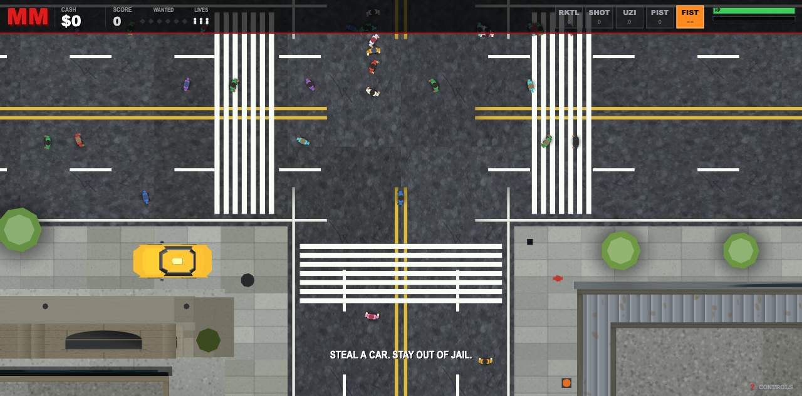
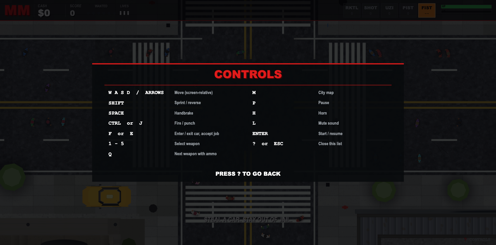
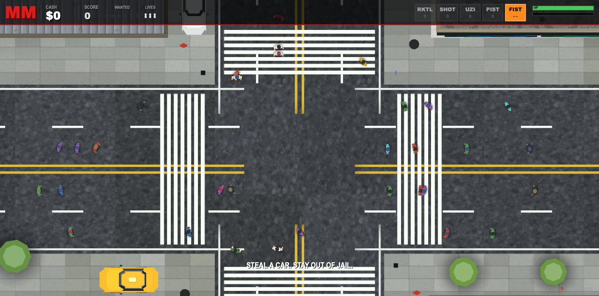

# METRO MAYHEM — a procedural top-down crime city in one HTML file

A GTA-style **top-down** city you can walk around, steal a car from, shoot your
way out of and get wanted for — in **one self-contained HTML file**. No assets,
no build step, no dependencies to install — just Three.js r128 pulled from cdnjs
and ~286 KB of procedural code.

| | |
|---|---|
| Deliverable | [`src/index.html`](src/index.html) — 6,507 lines, 285,618 bytes, single file |
| Renderer | three.js **r128** from cdnjs (the only external file) |
| Assets | none — all textures, geometry, animation and audio are generated at runtime |
| Build | none — open the file in a browser |
| Tests | [`tests/harness/`](tests/harness/) — headless Chrome + SwiftShader, Node built-ins only |
| History | 9 build commits (plus docs commits) — the whole build is measurable, see [How long it took](#how-long-it-taken-measured-from-git) |

Everything in this repository — the 6,507-line artifact and the entire test
harness — was generated by an AI agent, end to end.

> **On the name.** The folder and the original brief say `gta1`; the in-game
> brand is **METRO MAYHEM** (`MM`), and the three cities are **Meridian City**,
> **Pacific City** and **Palm City**. The rename was a playtest-time request, and
> `docs/agent/PROJECT_STATE.md` records which strings were swept and which ~75
> street/district names were deliberately left alone.

---

## Screenshots

All frames are real captures from the artifact, taken headless at 1280×633
(SwiftShader) by the harness in [`tests/harness/`](tests/harness/).

**Top-down plan view at spawn** — the camera is a straight-down orthographic
rig, so this is the actual play view: the player straddling the double-yellow
centre line, a yellow taxi-top vehicle parked on the pavement, crosswalks,
rooftops, trees and traffic in frame at once. HUD strip reads `MM` / `CASH` /
`SCORE` / `WANTED` / `LIVES`, the five weapon slots
(`RKTL SHOT UZI PIST FIST`), health/armour bars, and the permanent
`? CONTROLS` chip bottom-right.



**The controls sheet (`?`)** — one key away at any time, two columns, and it
returns to whichever screen it covered (title, play, map or pause).



**The invisible-player bug (before)** — kept deliberately. Same camera, same
build, one frame apart in time from the first image above: the player model was
being detached from the scene graph on every city rebuild, so a whole session
played as an invisible man while the camera, physics, collisions and the peds'
flee logic all kept working on a model that was never drawn.



The root cause, the four-way proof and the gate that now catches it are written
up in
[`docs/agent/PROJECT_STATE.md`](docs/agent/PROJECT_STATE.md) — it is the single
most instructive thing in this repo.

---

## How this was made

- **Agent harness:** [Qwen Code](https://github.com/QwenLM/qwen-code), run with
  `qwen --fast`
- **Models — three in total:**
  - **Primary:** **Qwen 3.8 Flash Next** — the model the reference run below
    already names as its own
  - **Fast:** **2 × `Qwen3.6-35B-A3B-GGUF:UD-Q4_K_S`**, running **in parallel**
    on one machine, wired in as Qwen Code's `--fast` model
- **Hardware:** Apple **MacBook, M1 Max, 64 GB** unified memory

### This is a follow-up to an existing experiment

The method here is not original. This repo is a **follow-up** to
**[kireol/qwen3.8_GTA_one_shot_test](https://github.com/kireol/qwen3.8_GTA_one_shot_test)**,
which documented the approach — one prompt, one self-contained HTML artifact,
procedural everything, its own headless harness. Go read that README first.

Not a fork: no code, no git history and no assets were carried over from it —
this repository's history has exactly one root commit (`254dbcc`, its own
baseline), so nothing was imported. What is inherited is the *method* and the
primary model. **The only change made to that setup was the context window: 128K
instead of 64K.**

```
Primary model: Qwen 3.8 Flash Next
Fast model   : 2 × Qwen3.6-35B-A3B-GGUF:UD-Q4_K_S (Unsloth UD-Q4_K_S), in parallel
Context      : 128K (131,072 tokens)   <- the one deviation from the reference setup
Hardware     : Apple MacBook, Apple M1 Max, 64 GB unified memory
Renderer     : WebGL; headless verification runs on SwiftShader (software GL)
```

The reference README pins its own build as
`qwen3.8-flash-next-unsloth-ud-iq4_xs-v31` (Unsloth UD-IQ4_XS Dynamic v3.1) on an
AMD Ryzen 7 9800X3D + RTX 5080; this follow-up keeps that model and moves the
fast role onto two local 35B-A3B copies. Two Q4_K_S MoE instances side by side is
what the 64 GB unified-memory box is for: the weights are memory-resident rather
than VRAM-resident, so the parallel pair fits where a discrete-GPU rig would have
to offload.

Worth spelling out what the 128K window bought, because it is the point of the
experiment: the artifact grew to **285,618 bytes**, i.e. well past what a 64K
window can hold even once. Every late fix in this project — the invisible-player
root cause, the NaN geometry hunt, the camera rework — was made against a file
larger than the reference run's entire context, which is the reason this repo
grew a 1,470-line test harness instead of relying on the model re-reading its
own code.

### The prompt

The only prompt used to create this project was **two links** — no spec, no
file list, no acceptance criteria, no architecture notes:

> GTA 1: https://en.wikipedia.org/wiki/Grand_Theft_Auto_(video_game)
>
> Gameplay: https://www.youtube.com/watch?v=ahOIJNLLtkI&t=1s

Everything the agent knew about what to build came from the wiki page and the
gameplay video. No follow-up prompt added a feature; the only later turns were
playtest reports ("I don't see any people", "A and D feel swapped", "I see other
people now, but not the main character") plus two naming/UX decisions.

---

## How long it took (measured from git)

Nine **build** commits — `2026-11-06 10:18:13` → `2026-11-07 13:48:06`
(UTC−05:00). The README, its screenshots and the project notes are later commits;
they added no game code, so the build is measured over these nine:

> **27 h 29 m 53 s of wall-clock span**, producing **6,507 lines / 285,618
> bytes of game** and **1,470 lines / 76,677 bytes of headless test driver**
> (`tests/harness/mk_smoke.js` — the folder is 1,559 lines once you count
> `run.sh`, `rd.py`, `undeclared.js` and the vendored `three128.js`).

Elapsed between consecutive commits, with the code each phase actually produced:

| Elapsed | Phase | Game code | Harness |
|---|---|---|---|
| — | `254dbcc` Baseline: city generator, actor kit, FX (chunks 1–4a) | +3,807 | — |
| 0:44:48 | `a4f538c` Chunk 4b: vehicle physics, collisions, damage, crowds, camera | +750 / −14 | — |
| 0:48:52 | `add6241` On-foot runaway velocity fix; island boundary colliders | +7 / −1 | — |
| 6:38:43 | `ba13cd0` NaN-geometry hunt; **the harness is born** | +32 / −26 | +376 |
| 3:22:44 | `53f78fc` Boarding radius + throttle drag; crash and run-over proven headless | +9 / −4 | +341 |
| 5:58:26 | `7c03886` Chunk 4c: weapons, wanted-level police, pickups, markers, missions | +1,160 / −1 | +283 |
| 5:03:56 | `0229719` Chunk 5: HUD, map, screens, main loop, `boot()` | +608 / −4 | +245 |
| 0:02:34 | `871b51c` PROJECT_STATE evidence note | — | — |
| 4:49:50 | `08b812c` Playtest round: **invisible-player fix**, plan camera, rebrand, `?` help | +228 / −44 | +403 |

Read the shape of that table, not just the total:

- **Features are cheap, verification is the bill.** Chunk 4c wrote 1,160 game
  lines in 5 h 58 m (~195 lines/h). The NaN-geometry phase took *longer* — 6 h 38 m
  — and changed **32** game lines while adding 376 lines of test code. Half the
  elapsed time of this project went into proving behaviour, not writing it.
- **The biggest single number is unknowable.** The baseline commit already
  contains 3,807 lines (chunks 1–4a): the repo started mid-build, so 27 h 30 m
  is a **floor** on the real authoring time, not a measurement of it.
- **This is calendar time, not machine time.** The span crosses an overnight
  break, and git cannot tell agent work from the operator being away from the
  keyboard. Treat "27.5 hours" as "ten hours of that day and the next one".
- Cumulatively the game file had **6,601 lines added** across all commits to land
  at 6,507 net, i.e. the churn was small — most edits were surgical, which is
  what a working harness is supposed to buy you.

---

## Controls

Straight from `HELPROWS`, the table the in-game sheet renders — press `?` at any
time, or read the permanent `? CONTROLS` chip in the corner.

| Key | Action |
|---|---|
| `W A S D` / `Arrows` | Move (screen-relative) |
| `Shift` | Sprint / reverse |
| `Space` | Handbrake |
| `Ctrl` or `J` | Fire / punch |
| `F` or `E` | Enter / exit car, accept job |
| `1`–`5` | Select weapon |
| `Q` | Next weapon with ammo |
| `M` | City map |
| `P` | Pause |
| `H` | Horn |
| `L` | Mute sound |
| `Enter` | Start / resume |
| `?` or `Esc` | Close this list |

`F12` is what every player reaches for, and **it cannot be bound**: the browser
and OS consume it before the page sees a keydown (on macOS `F12` is a hardware
media key), same story for `F1`. Hence `?`, with a reminder chip always on
screen. The keys the page does see and that would otherwise steal focus — the
four arrows, `Space`, `Tab`, both `Ctrl`, `M` and `/` — are `preventDefault`ed
(`PREVENT`, line 3499), so mid-drive you never get page scroll, a browser
quick-find, or the focus moving out of the canvas.

---

## What's in the world

- **City plan** — an 11×7 block grid (`NX:11 NZ:7`, `BLOCK:46 ROAD:13 SW:3.6`,
  `MAXB:40` buildings), streamed around the player on a 59 m stride
  (`STRIDE = BLOCK + ROAD`) so an infinite island never leaves the file. `FLOOR`
  is **storey height in metres** (3.4), which puts the tallest roof in the world
  at 13 storeys = 44.2 m — the reason `CAMH` has to clear the near plane.
- **Districts** — downtown, residential, industrial, civic/open, rail + station,
  waterfront and a neon strip, each with its own lot kit and facade modules, all
  painted from one procedural texture atlas.
- **Vehicles** — multiple kinds with suspension, throttle/drag, handbrake,
  crumple damage, and a real enter/exit (`F`) with boarding radius that had to
  be tuned against the harness.
- **Player** — a 7-part body with an animated gait, screen-relative steering,
  collision against a cell-indexed collider grid (`Colliders`:
  `add/near/resolve/blocked/groundH`), and run-over/being-run-over interactions.
- **Pedestrians** — crowds retuned for the plan camera (32 peds / 18 vehicles
  resident, 52 m despawn, 28–40 m spawn ring anchored on the player); they flee
  when you drive at them and die when you hit them.
- **Wanted level & police** — up to **six** stars of heat
  (`Math.min(6, floor(sqrt(heat)/1.9) + 1)`, six pips in the HUD), pursuit AI
  that drives, officers on foot, arrest and death handling with lives.
- **Weapons** — fist, pistol, uzi, shotgun, rocket; ammo, health and armour
  pickups; firing goes through the pooled effects system (`3549 effects`) and
  `SND.gunshot`.
- **Missions & money** — a case structure with markers, briefings, drop points,
  cash and score.
- **Audio** — one WebAudio graph, zero samples, 21 entry points: `engine` /
  `engineStop`, `skid`, `scrape`, `thud`, `crash`, `boom`, `splash`, `hurt`,
  `gunshot`, `siren`, `horn`, and the screen-state set (`menu`, `tick`,
  `pickup`, `cash`, `complete`, `fail`, `resume`) — all synthesized from
  `tone()` / `noise()`, with `setMute` / `isMute` behind `L`.
- **Screens** — title, city map (`M`), pause, help, death/bust/complete/game
  over, plus the HUD strip and a mission line.
- **Camera** — a true top-down **orthographic** plan view; `CFG.VIEWW` (line
  1062) is the only zoom knob, `CFG.CAMH` merely clears the near plane above the
  tallest roof.

### File map of `src/index.html`

One `"use strict"` ES5 classic script, one IIFE, banner-commented in build
order (line numbers are real):

```
    47  math/util · canvas helpers
   112  procedural texture atlas — ground, facades, sprites
   689  audio (all synth) — one graph, zero samples
   987  collision world
  1052  renderer  ·  1168 lighting  ·  1178 static geometry buckets
  1220  prop kinds · themes
  1317  the city — block kinds, ground, road paint, street furniture, assemble
  1622  prop kit — foliage, street props
  1874  building kit — facade details
  2071  lot kit — downtown, residential, industrial, civic/open,
          rail + station, waterfront, neon strip
  3048  actor kit — dynamic materials, vehicle kinds, peds, the player
  3494  input
  3526  game state · 3549 effects · 3757 dynamic actor registry
  3801  street routing · wanted
  3870  chunk 4b — messages, parked-car boxes, vehicle physics,
          vehicle/vehicle pairs, damage, spawning, player on foot,
          enter/leave, pedestrian, camera, player visuals, main step
  4681  chunk 4c — the case, gunshots, firing, money & health, police,
          aiDrive, aiPed, pickups, markers, death & bust, missions
  5840  chunk 5 — 2D kit, HUD, map screen, screens, state transitions,
          mode machine, per frame, boot
```

---

## Running it

```sh
open src/index.html          # macOS
```

Or serve it — `python3 -m http.server -d src 8000` — and open
`http://localhost:8000/index.html`. Needs network access for the cdnjs three.js
r128 script tag. Press `Enter` on the title screen to start, `?` for the keys.

If you open the file directly and the frame rate looks bad, try another browser
tab before believing the game is slow: the headless numbers below come from
SwiftShader, which is a software rasterizer.

## Testing

```sh
sh tests/harness/run.sh log missing errKinds counts c5
```

The pipeline: extract the inline `<script>` from `src/index.html` → `node
--check` → splice in a scripted driver (`mk_smoke.js`) plus a vendored
`three128.js` → run it in headless Chrome under a 60 s virtual-time budget →
parse the JSON report out of `<pre id="out">` with `rd.py`. Green is defined as
`missing {}` · `log []` · `errKinds {}` · `counts.stepErrs:0`.

The last full run: **exit 0**, 9,984 stepped frames, 0 errors, 0 render errors,
and these gates passing —

- `c5.play.ok true`: crosswalk corners project on screen, peds are inside the
  frustum and ≥16 px tall, the player projects to frame centre **and is
  reachable by the renderer** (`attach:1 inAct:1`);
- `c5.help.ok true`: the sheet renders over a live frame and dismisses on `?`;
- `c5.newgame {plyAttach:1 plyInAct:1 bad:0}`: actor arrays are consistent
  immediately after `newGame()` — the exact call path that used to orphan the
  player;
- `audit2 n 255 bad []` on the material/geometry inventory.

Append `?shot=1` (add `&help=1`) to the smoke URL to paint a real frame and have
the harness report its centre-pixel colour — that hook is what proved the
invisible-player fix, and it is how every screenshot above was captured.
`tests/harness/undeclared.js` is a standalone undeclared-identifier check for
the ES5 file. Eighteen headless run logs were written during the build.

---

## Known limitations

Things that are real, so you don't chase them:

- **Not yet verified in a real browser:** actual-GPU frame rate (`GS.fps`), the
  `PtPool` ShaderMaterial particle look, and the audio graph. All headless
  evidence comes from SwiftShader with no GPU. This is the obvious gap — the
  playtest is the reader's job.
- **On-foot travel can leave the world box to the south** (a soak run reached
  `z -11.21` outside the boundary). Known, open, and deliberately left out of
  the invisible-player commit.
- **No day/night cycle.** The reference experiment has one; this build does not.
- **`F12` / `F1` are not bindable** (see [Controls](#controls)); help is on `?`.
- **Cosmetic:** the player's head is built with `MAT.pant`, so hair and trousers
  share a material.
- **Balance is untested.** Weapons, wanted-level escalation and mission difficulty
  have been proven to *fire*, not to be fun.
- **Single 285 KB classic script**, ES5, no modules and no source maps — that is
  the deliverable constraint, not an oversight.

## Project docs

[`docs/agent/PROJECT_STATE.md`](docs/agent/PROJECT_STATE.md) keeps the running
checkpoint — decisions, verified fixes, evidence, open items — per
[`QWEN.md`](QWEN.md). It is where the chunk plan, the harness traps (driver-scope
`ReferenceError`s, the 200-char log cap, why `--screenshot` lies) and the
invisible-player post-mortem live.

## Links

- The experiment this one follows up on: https://github.com/kireol/qwen3.8_GTA_one_shot_test
- Reference material (the entire prompt):
  - https://en.wikipedia.org/wiki/Grand_Theft_Auto_(video_game)
  - https://www.youtube.com/watch?v=ahOIJNLLtkI&t=1s
- Agent harness: https://github.com/QwenLM/qwen-code
- Renderer: https://cdnjs.cloudflare.com/ajax/libs/three.js/r128/three.min.js
